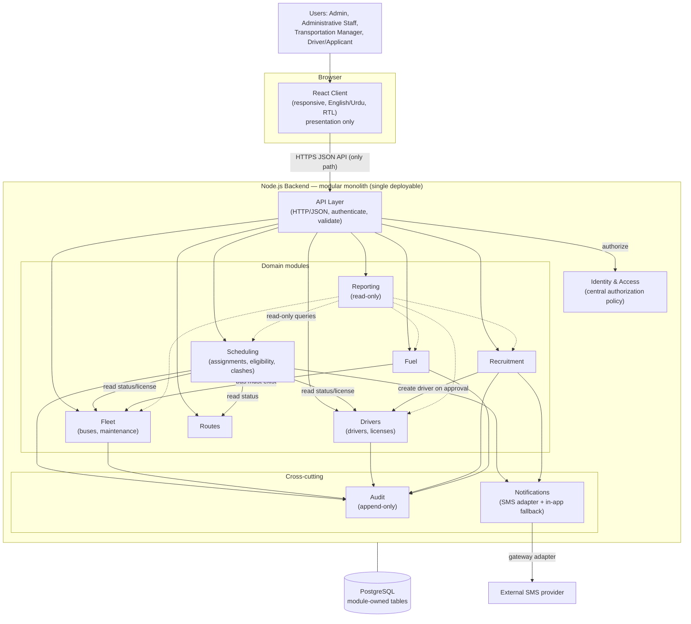

# Architecture — Bus Management System

**Source requirements:** `PRD.md` (v1.2). **Operational rules for AI agents:** `AGENTS.md`. **Decisions:** `ADR/`.
**Stack:** React client · Node.js API backend (modular monolith) · PostgreSQL (ADR-007).

---

## 1. System overview

The Bus Management System is a responsive web application that centralizes bus, driver, route and schedule information for a transport organization. The Transportation Manager is the primary client. It replaces registers, spreadsheets and messages.

It lets the Admin and Administrative Staff manage buses and their maintenance history, drivers and their licenses, routes, schedules and assignments, fuel purchases, driver recruitment, and operational reports. It prevents invalid assignments, alerts the Admin to schedule clashes, notifies by SMS with an in-app fallback, records critical changes in an audit log, and supports English and Urdu.

The system has three runtime parts:
1. a **React client** running in the user's browser;
2. a **Node.js backend** exposing an HTTP/JSON API, structured as a modular monolith;
3. a **PostgreSQL database** owned by the backend.

Out of scope (PRD §4, unconfirmed): payment processing, GPS/live tracking, automated route optimization. Passenger booking is an open blocker (D-03) and is **not** built until decided.

## 2. Architectural goals / drivers

1. **No invalid assignment can be saved**, by any path, including direct API calls (G-02, G-11).
2. **Isolate requirements that are still open**, so a client decision changes one place (clash, permissions, status timing, fuel calculation).
3. **Trustworthy history:** critical changes are always audited, and referenced records are never lost.
4. **Core operations keep working when SMS fails.**
5. **Simple to operate and restore** (4 hours) and able to grow to 250 concurrent users without redesign.
6. **Explicit, checkable boundaries** so an AI coding agent works inside the structure instead of inventing its own.
7. **The backend is the only authority.** The client never holds business rules or security decisions.

## 3. Architecture Significant Requirements (ASRs)

| ID | Summary | Source | Addressed by |
|---|---|---|---|
| ASR-01 | Assignment eligibility enforced on every path | BR-01/02/03/13 | Scheduling, ADR-004 |
| ASR-02 | Clash logic undefined and will change | FR-SCH-07–09, BR-04/05 | Scheduling policy, ADR-004 |
| ASR-03 | Incomplete, changing role matrix | FR-ACCESS, BR-06/07 | Identity & Access, ADR-003 |
| ASR-04 | Audit every critical change atomically | FR-AUD, BR-09 | Audit, ADR-005 |
| ASR-05 | SMS can fail; in-app fallback | FR-NOT, BR-10 | Notifications, ADR-005 |
| ASR-06 | Urdu/RTL, responsive, 4 browsers | FR-UI, NFR-01/02 | React client, ADR-007 |
| ASR-07 | 250 concurrent users without major change | NFR-03 | Stateless backend, ADR-001 |
| ASR-08 | Restorable within 4 hours | NFR-04 | One database, ADR-001/002 |
| ASR-09 | Public registration, personal data | NFR-05, FR-REC-01/02 | API auth boundary, ADR-003 |
| ASR-10 | Referenced records must not be lost | FR-BUS-03, FR-MNT-02, EC-10 | Archival, ADR-002 |
| ASR-11 | Cross-module date-range reporting | FR-REP, FR-FUEL-02 | Reporting read path, §6 |

Full derivation: `D3_Step1-2_ASRs_and_Decisions.md`.

## 4. Selected architectural style and rationale

**Backend: modular monolith** (ADR-001). One Node.js application, one PostgreSQL database (ADR-002), divided into modules with owned data and defined interfaces. **Client: React single-page application** (ADR-007) that communicates with the backend only through its API.

Rationale in brief: one transaction scope makes atomic audit possible; one deployable backend and one data store keep restoration simple; load is modest; module boundaries isolate volatile requirements; named modules give the AI agent explicit boundaries. Microservices were rejected as disproportionate; an unstructured backend was rejected because it invites coupling.

The React client is a separate codebase, but it is *not* a second system with its own logic: it is a presentation layer over the backend API.

## 5. Major components / modules

### 5.1 Client

| Component | Responsibility | Must NOT |
|---|---|---|
| **React Client** | Responsive screens, forms, navigation, English/Urdu text and RTL layout, display of results and errors, calls to the backend API. Hides actions the user is not permitted to use (convenience only). | Contain business rules (eligibility, clashes, permissions, fuel calculation); access the database; assume the user is authorized because a button is hidden |

### 5.2 Backend

| Component | Responsibility | Owns (data) | Must NOT |
|---|---|---|---|
| **API Layer** | The HTTP boundary: receives requests, authenticates, asks Identity & Access whether the capability is allowed, validates input shape, calls the right module's service, returns JSON and error codes | None | Contain business rules; read or write tables |
| **Identity & Access** | Authentication, sessions/tokens, roles, central authorization policy, role-to-capability matrix | Users, roles, capabilities | Contain business logic of other modules |
| **Fleet** | Bus records, bus status, archival, maintenance history (entries, chronological order), overdue-service identification | Buses, maintenance entries | Decide assignments |
| **Drivers** | Driver records, driver status, license number/category/expiry, expiring-license list (30 days) | Drivers, licenses | Decide assignments |
| **Routes** | Route records and Blocked/Unblocked status | Routes | Decide assignments |
| **Scheduling** | Schedules (departure, arrival, date, bus, driver, route); **the only creator of assignments**; enforces eligibility (BR-01/02/03/13); clash detection and Admin resolution; alternative-driver check (BR-04) | Schedules/assignments | Write to Fleet, Drivers or Routes data |
| **Recruitment** | Driver registration, applications, interview scheduling, approve/reject (BR-08) | Applicants, applications, interviews | Create schedules; give applicants access to the internal area |
| **Fuel** | Fuel purchase records (date, liters, cost, odometer); quantity/expenditure calculation for a date range | Fuel purchases | Own the definition of "bus" |
| **Reporting** | Trip, bus, driver, hiring, fuel and maintenance reports; license-expiry views | None (read-only) | Write data or read other modules' tables |
| **Notifications** | Notification requests, SMS gateway adapter, in-app fallback, language templates | Notifications | Block or roll back business operations |
| **Audit** | Append-only audit log: actor, timestamp, entity, action | Audit entries | Offer edit or delete of entries |

### 5.3 Boundary rules
- A module's tables and internals are **private**. Other modules use its public **service** (commands) and **query** (read-only) interface only. In the code, each module exposes its public interface from a single entry point and nothing else may be imported from it.
- The **React client may only call the API Layer.** It has no other path to data.
- Fleet, Drivers and Routes **never depend on Scheduling**.
- Allowed dependencies (arrow = "may call"):
  - API Layer → Identity & Access (authorize), then all domain modules
  - Scheduling → Fleet, Drivers, Routes (read), Notifications, Audit
  - Recruitment → Drivers (create driver on approval; details open, D-17), Notifications, Audit
  - Fuel → Fleet (bus must exist), Audit
  - Reporting → read/query interfaces of Fleet, Drivers, Routes, Scheduling, Recruitment, Fuel
  - Fleet, Drivers, Routes, Fuel → Audit
- Any dependency not listed is not allowed without an ADR.

## 6. Interfaces and interactions

### 6.1 Client ↔ Backend
- **HTTP/JSON API over HTTPS.** It is the only interface between client and backend.
- The API contract (resources, request/response shapes, error codes) is documented and updated whenever the API changes. The format is to be agreed with the team.
- Errors are returned as **stable error codes with data**, not display text. The client translates them into English or Urdu.
- Every request except public registration/application requires authentication. Authorization is decided by the backend on every request.

### 6.2 Between backend modules

| Provider | Offers | Used by |
|---|---|---|
| Identity & Access | Authenticate user; "is this user allowed capability X?" | API Layer |
| Fleet | Get bus and status; list buses; add/update/archive bus; add maintenance entry; list maintenance history; list overdue buses | Scheduling, Reporting, Fuel, API Layer |
| Drivers | Get driver and status; get license validity on a date; list expiring licenses; add/update driver and license | Scheduling, Recruitment, Reporting, API Layer |
| Routes | Get route and status; set status | Scheduling, Reporting, API Layer |
| Scheduling | Create/update/cancel schedule (with eligibility checks); detect clashes; resolve clash with alternative driver; query schedules | API Layer, Reporting |
| Recruitment | Register applicant; submit application; schedule interview; record decision; query applications | API Layer, Reporting |
| Fuel | Record purchase; fuel quantity and expenditure for bus and date range | API Layer, Reporting |
| Audit | Record entry **using the caller's database transaction** | All modules that make critical changes |
| Notifications | Request notification (event type, recipient, data, language); list in-app notifications | Scheduling, Recruitment, others later |

### 6.3 Key interactions

**Create a schedule/assignment.** Client sends a request → API Layer authenticates and checks the capability with Identity & Access → calls Scheduling → Scheduling reads bus, driver, license and route state from Fleet, Drivers, Routes → rejects with an error code if any of BR-01/02/03/13 fails → otherwise saves the schedule and records an audit entry in the same transaction → runs clash detection → after commit, requests an Admin alert from Notifications on a clash. The client shows the result or translated error.

**Direct API call with an ineligible driver.** The rules run in the backend regardless of what the client did, so the call is rejected the same way.

**SMS failure.** Notifications attempts SMS through the gateway adapter → on failure creates an in-app notification (BR-10). The business operation is unaffected. Notifications are recorded before sending so a crash after commit does not lose them.

**Report.** Client requests a report → API Layer checks capability → Reporting calls the query interfaces of the relevant modules → returns data → the client renders it in the selected language. Export/print is open (D-16).

## 7. External systems and services

| System | Role | Boundary |
|---|---|---|
| SMS provider (not yet chosen) | Delivers SMS | Accessed **only** by Notifications via a gateway adapter. Provider can be replaced without changing other modules. |
| Users' browsers (Chrome, Edge, Firefox, Safari — latest stable; NFR-02) | Run the React client | HTTPS to static client files and the backend API |

No other external systems are in scope. Payment, GPS and route-optimization services are out of scope.

## 8. Important data responsibilities

- **Single PostgreSQL database; each module owns its tables** (ADR-002). Table names/groupings identify the owning module. No cross-module direct table access.
- **Archival, not deletion:** removed buses and other referenced records are marked archived until D-09 is decided. Maintenance and audit entries are never physically deleted.
- **Audit:** append-only. Written in the same transaction as the change. Which actions are "critical" is a configurable, human-decided list (D-11).
- **Maintenance history:** retained per bus, displayed chronologically by service date. Tie-break for equal dates is open (D-19).
- **License and fuel data** are personal/financial operational data, protected under the security decisions of D-13.
- **Backend holds no per-user state in process memory** (sessions or tokens are verifiable by any instance), so more than one backend instance can run (ASR-07).
- **Language:** the client owns UI text; the backend owns SMS/notification templates and returns error *codes* and data, not display strings.
- **Client data:** the client holds only what the user is allowed to see and is never a source of truth. It must not store sensitive data beyond what is needed (mechanism under D-13).

## 9. Architectural constraints

1. Backend is a modular monolith. No microservices, message brokers or additional data stores without an ADR.
2. React client + Node.js backend + PostgreSQL (ADR-007). Other technology (frameworks, libraries) only as decided in ADR-007 or approved by humans.
3. The client calls only the backend API and contains no business rules or security decisions.
4. Authorization is server-side, central, and applied on every API request (ADR-003). No auto-generated CRUD endpoints or admin panels that bypass module services.
5. Only Scheduling creates or changes assignments (ADR-004).
6. Critical changes are audited in the same transaction (ADR-005). Notification failure never fails a business operation.
7. All user-facing text is translatable (English and Urdu), including RTL layout.
8. No behavior is implemented for open decisions (§11) until the client decides; the agent raises them as questions.
9. Passenger booking is not built until D-03 is decided.

## 10. Architecture diagram

Solid arrows are allowed call directions; dotted arrows are read-only. Fleet, Drivers and Routes have no arrow to Scheduling by design. The client has no arrow to anything except the API Layer.

## 11. Open decisions that constrain implementation

These PRD items are unresolved. The agent must not invent behavior for them; it must stop and ask.

| Decision | Affects | Handling until decided |
|---|---|---|
| D-01 clash definition | Scheduling clash policy | Structure the policy interface only; do not implement detection logic |
| D-02 roles/permissions | Identity & Access | Capability model in place; matrix content comes from humans |
| D-03 passenger booking | Reporting FR-REP-04, Passenger role | Not built |
| D-04 default route/driver on bus | Fleet/Scheduling data model | Raise before modelling bus-to-route/driver |
| D-05 status timing, future schedules | Scheduling | Check eligibility at save time only; no re-validation rules |
| D-09 delete vs archive | All modules | Archive |
| D-10 notification events/failure | Notifications | Build channel and fallback mechanism; do not invent events or retry rules |
| D-11 critical actions, audit viewers, retention | Audit | Configurable list; no invented list |
| D-13 security/privacy, session mechanism | Identity & Access, client | Raise before choosing token/session storage or password handling |
| D-15 Urdu scope | Client, Notifications, Reporting | Build RTL and translation structure; coverage decided by humans |
| D-17 recruitment details | Recruitment | Raise before modelling applicant fields and statuses |
| D-21 fuel consumption method | Fuel | Isolate calculation in one function; liters-purchased as placeholder only if approved |

Technology sub-choices still awaiting team confirmation (ADR-007): TypeScript, the Node.js application framework, the database access approach.

## 12. Architecture Decision Records

| ADR | Title | Status |
|---|---|---|
| [ADR-001](ADR/ADR-001-architecture-style.md) | Architecture style — modular monolith | Accepted |
| [ADR-002](ADR/ADR-002-data-persistence.md) | Data persistence and ownership | Proposed |
| [ADR-003](ADR/ADR-003-authentication-authorization-boundary.md) | Authentication and authorization boundary | Proposed |
| [ADR-004](ADR/ADR-004-assignment-eligibility-and-clash-policy.md) | Assignment eligibility and clash policy | Proposed |
| [ADR-005](ADR/ADR-005-audit-and-notification-integration.md) | Audit and notification integration | Proposed |
| [ADR-006](ADR/ADR-006-technology-stack.md) | Django stack | Superseded by ADR-007 |
| [ADR-007](ADR/ADR-007-technology-stack-react-node-postgresql.md) | Technology stack — React, Node.js, PostgreSQL | Accepted (sub-choices proposed) |
